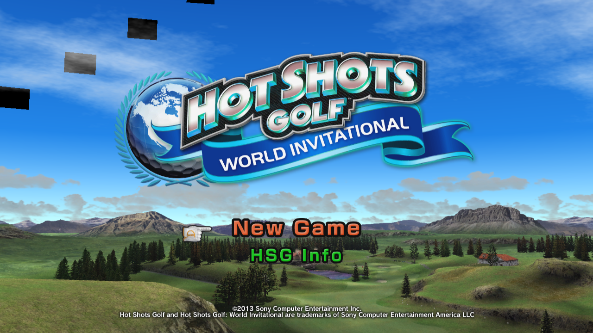

# Hot Shots Golf: World Invitational PC Port (PS3 Static Recompilation)

A native Windows port of the PS3 game Hot Shots Golf: World Invitational (US, `NPUA80864`, known as Everybody's Golf 6 outside North America), made by statically recompiling the PS3 executable to x86-64 with [ps3recomp](https://github.com/sp00nznet/ps3recomp). No emulator runs underneath it.

**It is not playable yet.** The build compiles, starts, opens a D3D12 window, runs the game's boot code, draws the autosave notice, the loading screens, the JAPAN Studio logo and the title screen, and takes "New Game" from a scripted button press. The intro movie is skipped because there is no video decoder. Nothing here will let you play golf today.



The title screen, drawn by the port and captured 2026-11-17. The dark squares at the top left are a rendering bug.

## Status

Updated 2026-11-17.

| Stage | State |
| --- | --- |
| Decrypt and extract the packages | Done for the fixed 1.02 profile |
| Lift PPU code to C++ | Done: 33,221 functions |
| Build a native executable | Done: one 446 MB `.exe`, no extra DLLs |
| Boot | Runs to the title screen in about a minute. Both SPURS instances start and game archives load |
| SPU jobs | 14 jobs lifted. No job is missing up to the title screen |
| Rendering | Works up to the title screen, with a few wrong squares in the sky. 8 to 20 FPS there |
| Intro movie | Skipped. The player reports the movie as finished because there is no video decoder |
| Input | A scripted Cross press starts "New Game": the game writes a save and loads the next scene. Not tested with a real controller |
| Menus after the title, gameplay, audio | Not verified |

Details and evidence are in [docs/STATUS.md](docs/STATUS.md) and [docs/orchestration/STATE.md](docs/orchestration/STATE.md).

## What is in this repository

- `port/`: the host program (`main.cpp`, CMake build) that links the lifted game code against the ps3recomp runtime.
- `tools/`: the pipeline runner and package inventory script.
- `pipeline.toml`, `config/`: the staged, hash-locked pipeline (analyze, SPU, lift, build) and the pinned inputs.
- `patches/runtime/`: fixes to ps3recomp found while porting this game, as patch files against commit `ae92407`.
- `docs/`: status, process and research notes.

## What is not in this repository

No game files. No packages, no decrypted executables, no assets, no licenses or keys, no lifted game code, no shader microcode. You supply your own copy of the game, and the pipeline generates everything else on your machine.

## Game version

The port targets a third-party fixed 1.02 executable. Sony's latest version is 1.03. The official 1.00 to 1.03 executables need a license file this project does not have, so they stay encrypted here. Do not read this as 1.03 compatibility.

## Building

You need Windows 10 or 11 on x86-64, a D3D12 GPU, Python 3.11 or newer, LLVM-MinGW, CMake, Ninja, about 10 GB of disk space, and your own game packages.

1. Clone this repository and place ps3recomp at `external/ps3recomp`, checked out at `ae92407bb1d899e3d32143e360fe6e6d4d8fa1b5`.
2. Apply every patch in `patches/runtime/` to it with `git apply`.
3. Put LLVM-MinGW at `external/llvm-mingw` and create a Python environment at `.venv`.
4. Extract your packages into `work/` as described in [docs/recomp-process.md](docs/recomp-process.md).
5. Run the pipeline:

```bash
.venv/Scripts/python.exe tools/recomp_pipeline.py analyze spu lift build
```

The lift writes about 2.3 GB of C++ and the first build takes a long time. Later runs skip stages whose inputs have not changed.

## Release goals

These apply before any binary is published:

1. One executable. No separate builder program.
2. Portable by default. Every file stays in the executable's folder, so deleting the folder removes the game.
3. A plain tarball next to any AppImage.
4. A command-line flag for every setting.

## Credits

- [ps3recomp](https://github.com/sp00nznet/ps3recomp) by sp00nznet: the lifter and runtime this port is built on.
- Hot Shots Golf: World Invitational was developed by Clap Hanz and published by Sony Computer Entertainment. This project has no connection to either company.

## License

The code in this repository is MIT licensed. See [LICENSE](LICENSE). The game is not covered by that license and is not distributed here.
