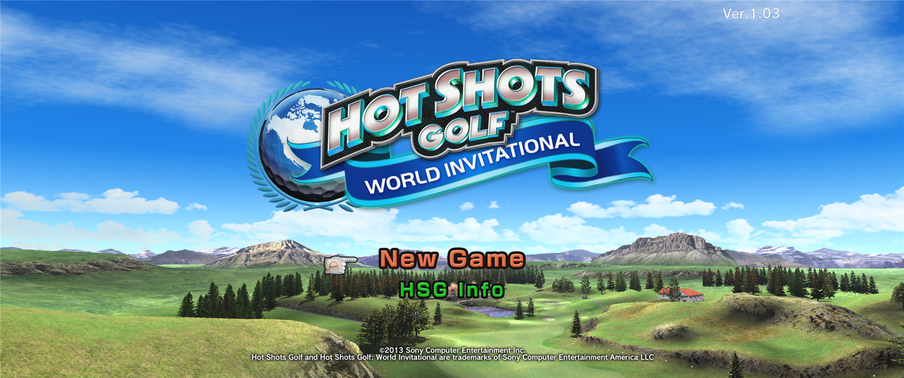
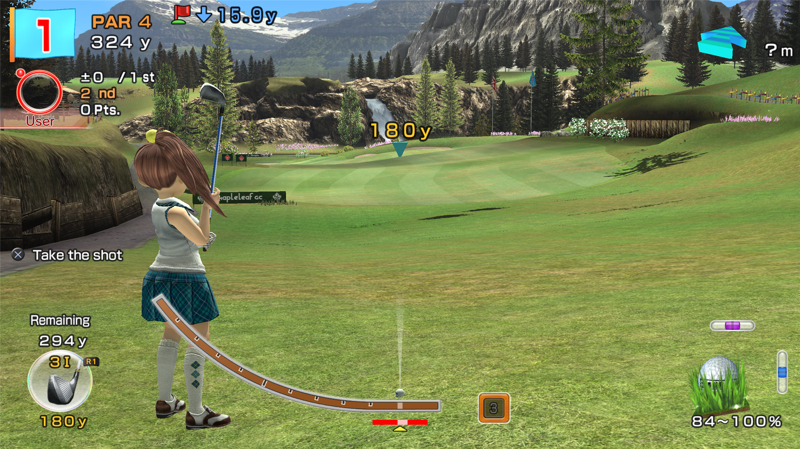
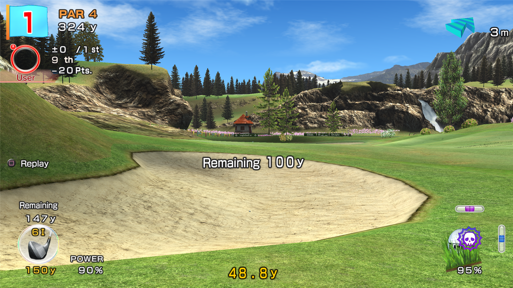
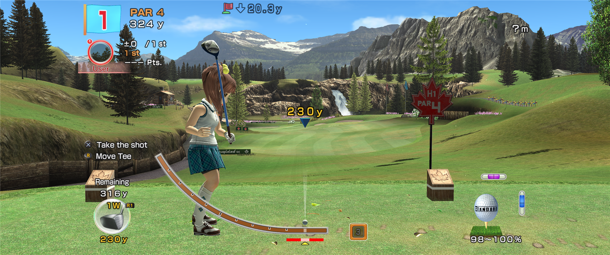
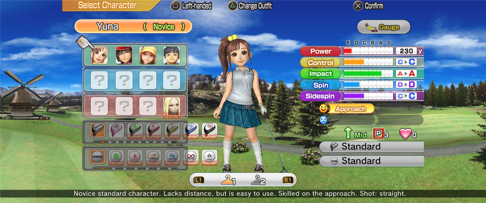
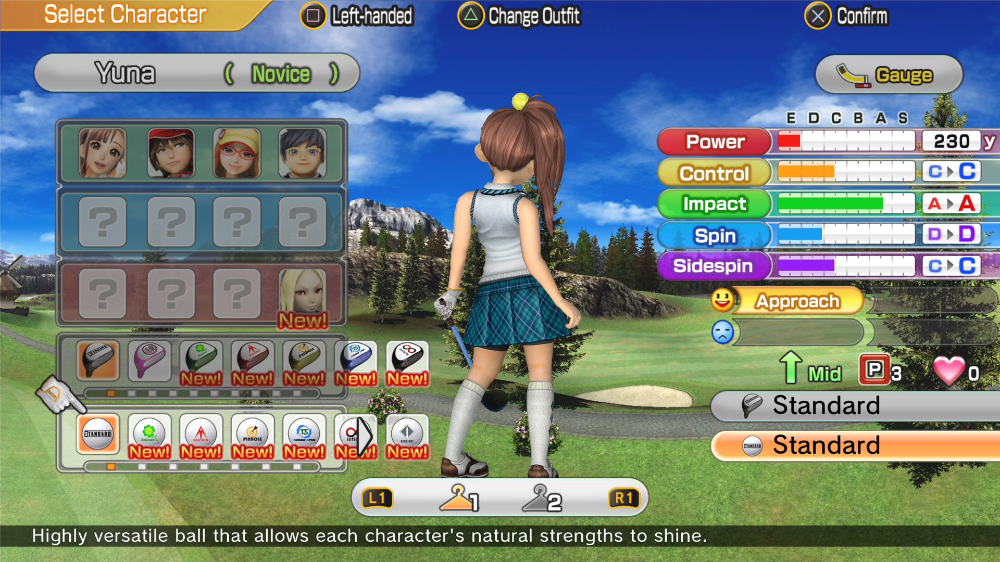

# Hot Shots Golf: World Invitational PC Port (PS3 Static Recompilation)

A native Windows port of the PS3 game Hot Shots Golf: World Invitational (US, `NPUA80864`, known as Everybody's Golf 6 outside North America), made by statically recompiling the PS3 executable to x86-64 with [ps3recomp](https://github.com/sp00nznet/ps3recomp). No emulator runs underneath it.

**It is playable.** The port targets the official update 1.03. It boots, shows the menus and plays full rounds with a keyboard or an Xbox-style controller. It runs at any resolution, including 1440p and 4K, with ultrawide support, HD texture packs and an opt-in 60, 90 or 120 FPS mode on the course. Intro and cutscene movies are skipped because there is no video decoder.

You must own the game. The game's code and data belong to Sony and Clap Hanz, and this project distributes no game files. See [Playing](#playing) for what you supply.













Captured from the current build: the 1440p and 16:9 shots on 2026-11-22, the ultrawide shots on 2026-11-21. The 1440p course shots use an HD texture pack built from the owner's own game files.

## Status

Updated 2026-11-22.

| Area | State |
| --- | --- |
| Game version | Official US 1.03 (`Ver.1.03` on the title screen) |
| Boot, menus, rounds | Work. Full rounds play from the title through the leaderboard |
| Resolution | Any size from 160 to 16384 px, including 1440p and 4K. `--aspect fit` keeps 16:9 with black bars; `--aspect expand` widens the view for ultrawide screens |
| HD textures | `--tex-dump`, `--tex-replace` and `tools/make_hd_pack.py` build and load replacement packs. No pack is included |
| Frame rate | 30 by default. Opt-in 60, 90 or 120 FPS on the course (`HSG_FPS`) by interpolating frames; game logic stays at 30. Menus stay at 30 |
| Shadows | Opt-in sharper shadow maps (`RSX_SHADOW_SCALE`) |
| Timing and stability | 59.94 Hz timing, cuts to shader-compile stutter, and no "Not Responding" freezes during render stalls |
| Launcher | `tools/hsg_launcher.py`: a Tkinter settings window. Settings are in `hsg_settings.json` and logs go to `logs/` |
| Input | Xbox-style controllers (XInput) and the keyboard |
| Audio | The mixer produces sound |
| Intro and cutscene movies | Skipped. There is no video decoder |
| Known gaps | First-time shader compiles still pause on a cold cache. Some visuals have not been compared with a real PS3 |

Details and evidence are in [docs/STATUS.md](docs/STATUS.md), [docs/MODERN-PC-ROADMAP.md](docs/MODERN-PC-ROADMAP.md) and [docs/orchestration/STATE.md](docs/orchestration/STATE.md).

## Playing

The release zip (`HotShotsGolfRecomp-<date>-win64.zip`) holds the game program and a settings launcher. It holds no game files. You need your own copy of the game, and you must own it.

**In the zip**

- `HotShotsGolfRecomp.exe`: the game, about 264 MB, no extra DLLs.
- `hsg_launcher.py` and `Play Hot Shots Golf.cmd`: a settings window (resolution, aspect, window mode, frame rate, HD textures) that starts the game. It needs Python 3 with Tkinter, which the python.org installer includes.
- `hsg_settings.json`: starting settings with paths relative to this folder.

**What you supply, in the same folder as the exe**

| Item | Where | How to get it |
| --- | --- | --- |
| `EBOOT.elf` | next to the exe | The decrypted executable from the official 1.03 update for the US game (`NPUA80864`). The exe checks it against a known hash and refuses any other file. |
| `game/` | next to the exe | The extracted base game: `PARAM.SFO` and `USRDIR/` from the 1.00 package. |
| `dev_flash/` | next to the exe | The firmware folder from your own `PS3UPDAT.PUP`. The game needs its fonts (`data/font/`). |

The official executables are encrypted with a per-game license file. This project decrypted the 1.03 `EBOOT.elf` in RPCS3 with the owner's own license file for the title. You need to do the same with your own license. The project does not supply one. [docs/recomp-process.md](docs/recomp-process.md) describes the extraction steps.

**Start the game**

1. Put the three items next to the exe.
2. Double-click `Play Hot Shots Golf.cmd`, check the settings, and press Play. Without Python, run the exe with flags instead, for example:
   `HotShotsGolfRecomp.exe --elf EBOOT.elf --game-dir game --dev-flash dev_flash --width 1920 --height 1080 --aspect fit`
   All flags are in [docs/CLI.md](docs/CLI.md).
3. Saves, caches and logs stay in this folder (`hdd0`, `hdd1`, `savedata`, `cache`, `logs`). Delete the folder to remove everything.

**Options**

- Resolution: any size, including 1440p and 4K. `--aspect fit` keeps 16:9 with black bars. `--aspect expand` widens the view for ultrawide screens.
- Frame rate: set `fps` to 60, 90 or 120 in the launcher (`HSG_FPS`). This applies on the course only. Game logic stays at 30 and menus stay at 30 FPS.
- HD textures: `--tex-replace <folder>` loads replacement textures. Build a pack from your own game with `--tex-dump` and `tools/make_hd_pack.py` (repository). No pack is included.
- Sharper shadows are opt-in (`RSX_SHADOW_SCALE=2` to `4`).

**Controls.** Xbox-style controllers work. The keyboard works when no controller is connected. See the table in the README.

**Needs.** Windows 10 or 11 on x86-64, a D3D12 GPU, and about 4 GB of free disk space for the game files, saves and caches. No minimum CPU, GPU or RAM has been tested; it was developed on a high-end Windows 11 PC. The first run on a new shader cache pauses while shaders compile.

**Known gaps.** Intro and cutscene movies are skipped because there is no video decoder. First-time shader compiles can still pause on a cold cache. Some visuals have not been compared with a real PS3.

## Controls

| PS3 | Controller (XInput) | Keyboard |
|---|---|---|
| Cross, Circle, Square, Triangle | A, B, X, Y | Z, X, A, S |
| L1, R1 | LB, RB | Q, W |
| L2, R2 | LT, RT | 1, 2 |
| Start, Select | Start, Back | Enter, Tab |
| D-pad and left stick | D-pad, left stick | Arrow keys |

The keyboard is used when no controller is connected, and only while the game window has focus.

## What is in this repository

- `port/`: the host program (`main.cpp`, CMake build) that links the lifted game code against the ps3recomp runtime.
- `tools/`: the pipeline runner and package inventory script.
- `pipeline.toml`, `config/`: the staged, hash-locked pipeline (analyze, SPU, lift, build) and the pinned inputs.
- `patches/runtime/`: fixes to ps3recomp found while porting this game, as patch files against commit `ae92407`.
- `docs/`: status, process and research notes.

## What is not in this repository

No game files. No packages, no decrypted executables, no assets, no licenses or keys, no lifted game code, no shader microcode. You supply your own copy of the game, and the pipeline generates everything else on your machine.

## Game version

The port targets the official 1.03 executable (`pipeline-1.03.toml`). An older profile for a third-party fixed 1.02 executable is still in the repository (`pipeline.toml`) but is not the supported build.

## Building

Most players should use the release zip. To build it yourself you need Windows 10 or 11 on x86-64, a D3D12 GPU, Python 3.11 or newer, LLVM-MinGW, CMake, Ninja, about 10 GB of disk space, and your own game packages.

1. Clone this repository and place ps3recomp at `external/ps3recomp`, checked out at `ae92407bb1d899e3d32143e360fe6e6d4d8fa1b5`.
2. Apply every patch in `patches/runtime/` to it with `git apply`.
3. Put LLVM-MinGW at `external/llvm-mingw` and create a Python environment at `.venv`.
4. Extract your packages into `work/` as described in [docs/recomp-process.md](docs/recomp-process.md).
5. Run the pipeline for the official 1.03 profile:

```bash
.venv/Scripts/python.exe tools/recomp_pipeline.py --config pipeline-1.03.toml analyze spu lift build
```

The lift writes about 2.3 GB of C++ and the first build takes a long time. Later runs skip stages whose inputs have not changed. The executable is written to `build/official-1.03/`.

## Release goals

1. One ready-to-run executable with a small settings launcher. Players do not build anything.
2. Portable by default. Every file stays in the executable's folder, so deleting the folder removes the game.
3. A command-line flag for every setting.

## Credits

- [ps3recomp](https://github.com/sp00nznet/ps3recomp) by sp00nznet: the lifter and runtime this port is built on.
- Hot Shots Golf: World Invitational was developed by Clap Hanz and published by Sony Computer Entertainment. This project has no connection to either company.

## License

The code in this repository is MIT licensed. See [LICENSE](LICENSE). The game is not covered by that license and is not distributed here.
